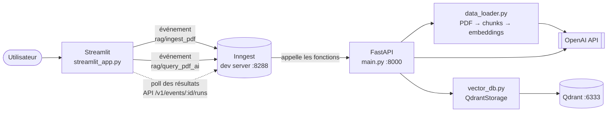
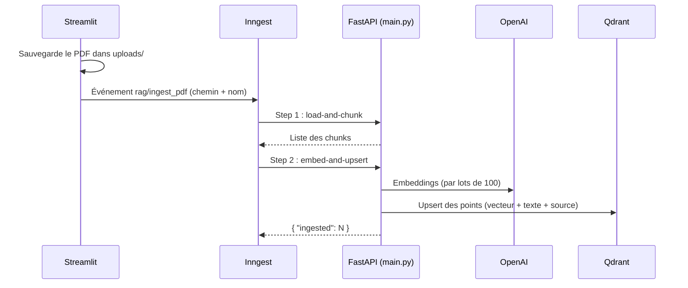
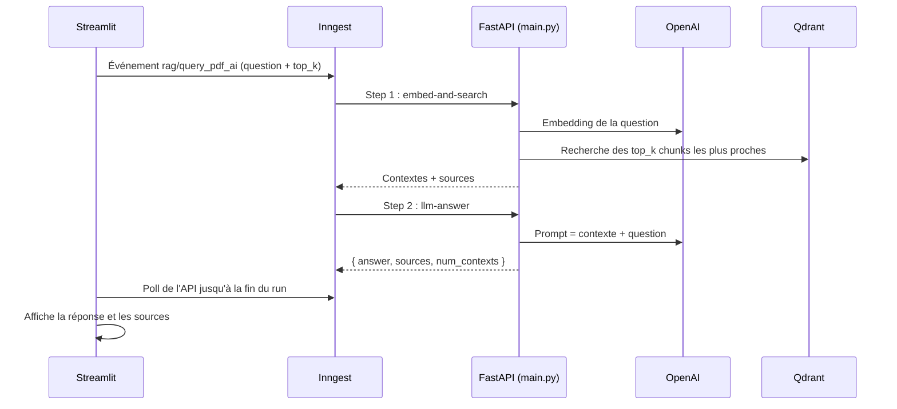

<div align="center">

# 📚 RAG Production App

**Posez des questions à vos PDF. Obtenez des réponses sourcées.**

Pipeline RAG (Retrieval-Augmented Generation) orchestré par des workflows durables :
ingestion de PDF, vectorisation, recherche sémantique et génération de réponses.


</div>

---

## Sommaire

- [Pourquoi ce projet ?](#pourquoi-ce-projet-)
- [Fonctionnalités](#fonctionnalités)
- [Architecture](#architecture)
- [Comment ça marche](#comment-ça-marche)
- [Structure du projet](#structure-du-projet)
- [Prérequis](#prérequis)
- [Installation](#installation)
- [Configuration](#configuration)
- [Lancer l'application](#lancer-lapplication)
- [Utilisation](#utilisation)
- [Référence des événements Inngest](#référence-des-événements-inngest)
- [Choix techniques](#choix-techniques)
- [Dépannage](#dépannage)
- [Limites connues et pistes d'évolution](#limites-connues-et-pistes-dévolution)

---

## Pourquoi ce projet ?

Un chatbot « classique » invente des réponses quand il ne connaît pas un document.
Le RAG résout ce problème : au lieu de se fier à sa mémoire, le modèle reçoit **uniquement les
passages pertinents de vos documents** et répond à partir d'eux.

Ce dépôt montre une implémentation **orientée production** de ce schéma :

- chaque étape (lecture du PDF, embeddings, recherche, génération) est un **step durable** Inngest :
  relances automatiques en cas d'erreur, historique complet et observabilité ;
- l'ingestion est **idempotente** : ré-envoyer le même PDF met à jour les données au lieu de les dupliquer ;
- l'interface, l'API et la base vectorielle sont **découplées** et peuvent évoluer indépendamment.

## Fonctionnalités

| | Fonctionnalité | Détail |
|---|---|---|
| 📄 | Ingestion de PDF | Extraction du texte puis découpage en chunks de 1000 tokens avec 200 de recouvrement |
| 🧠 | Embeddings | `text-embedding-3-large` (3072 dimensions), envoyés par lots de 100 |
| 🔎 | Recherche sémantique | Similarité cosinus dans Qdrant, nombre de passages (`top_k`) réglable de 1 à 20 |
| 💬 | Réponses sourcées | Le LLM répond à partir du contexte récupéré et l'app affiche les documents sources |
| 🔁 | Workflows durables | Étapes rejouables, suivies dans le dashboard Inngest |
| ♻️ | Ingestion idempotente | Identifiants de chunks déterministes (UUID v5 dérivé du nom de source et de la position) |

## Architecture



Trois processus applicatifs, plus la base vectorielle :

1. **Streamlit** : interface utilisateur. Elle ne parle jamais directement à OpenAI ni à Qdrant,
   elle se contente d'émettre des événements et de lire leurs résultats.
2. **FastAPI + Inngest** : héberge les deux fonctions de workflow (`ingest` et `query`).
3. **Inngest Dev Server** : planifie l'exécution des steps, gère les relances et expose l'historique.
4. **Qdrant** : stocke les vecteurs et les textes associés.

## Comment ça marche

### Ingestion (`rag/ingest_pdf`)



### Question / réponse (`rag/query_pdf_ai`)



Si aucun passage pertinent n'est trouvé, l'application le dit explicitement au lieu de laisser
le modèle improviser.

## Structure du projet

```
.
├── main.py             # App FastAPI + fonctions Inngest (ingestion et requête)
├── data_loader.py      # Lecture du PDF, découpage en chunks, embeddings OpenAI
├── vector_db.py        # Classe QdrantStorage (création de collection, upsert, recherche)
├── custom_types.py     # Modèles Pydantic échangés entre les steps
├── streamlit_app.py    # Interface : upload de PDF et questions
├── pyproject.toml      # Dépendances (gérées avec uv)
├── uv.lock             # Versions verrouillées
├── .env.example        # Modèle de configuration
└── .python-version     # Version de Python utilisée en local
```

## Prérequis

- **Python 3.11 à 3.13** (3.12 recommandé)
- [**uv**](https://docs.astral.sh/uv/) pour gérer l'environnement et les dépendances
- [**Docker**](https://docs.docker.com/get-docker/) pour lancer Qdrant
- [**Node.js**](https://nodejs.org/) (pour `npx`) afin de lancer l'Inngest Dev Server
- Une **clé API OpenAI**

## Installation

```bash
git clone https://github.com/fz-hazem/RAG_Production_App.git
cd RAG_Production_App

# Installe les dépendances exactement aux versions verrouillées
uv sync

# Crée votre fichier de configuration
cp .env.example .env
```

Ouvrez ensuite `.env` et renseignez au minimum `OPENAI_API_KEY`.

## Configuration

Toute la configuration passe par des variables d'environnement (fichier `.env`, chargé automatiquement).

| Variable | Obligatoire | Défaut | Rôle |
|---|:---:|---|---|
| `OPENAI_API_KEY` | ✅ | — | Clé utilisée pour les embeddings et la génération |
| `CHAT_MODEL` | | `gpt-4o-mini` | Modèle OpenAI qui rédige la réponse |
| `EMBED_MODEL` | | `text-embedding-3-large` | Modèle d'embeddings (voir l'avertissement ci-dessous) |
| `QDRANT_URL` | | `http://localhost:6333` | Adresse du serveur Qdrant |
| `INNGEST_API_BASE` | | `http://127.0.0.1:8288/v1` | API de l'Inngest Dev Server, utilisée par Streamlit pour lire les résultats |

> ⚠️ **Changer `EMBED_MODEL`** : la collection Qdrant est créée avec 3072 dimensions
> (`EMBED_DIM` dans `data_loader.py`). Un autre modèle produit des vecteurs de taille différente.
> Dans ce cas, adaptez `EMBED_DIM` et supprimez la collection existante, sinon l'insertion échouera.

## Lancer l'application

Ouvrez **quatre terminaux** à la racine du projet.

**1. Qdrant** (base vectorielle)

```bash
docker run -p 6333:6333 -v "$(pwd)/qdrant_storage:/qdrant/storage" qdrant/qdrant
```

**2. API FastAPI** (héberge les fonctions Inngest)

```bash
uv run uvicorn main:app --reload
```

**3. Inngest Dev Server** (orchestrateur et dashboard)

```bash
npx inngest-cli@latest dev -u http://127.0.0.1:8000/api/inngest --no-discovery
```

**4. Interface Streamlit**

```bash
uv run streamlit run streamlit_app.py
```

| Service | URL |
|---|---|
| Interface utilisateur | http://localhost:8501 |
| Dashboard Inngest (runs, steps, logs) | http://localhost:8288 |
| Dashboard Qdrant (collections, points) | http://localhost:6333/dashboard |
| Documentation de l'API FastAPI | http://localhost:8000/docs |

## Utilisation

1. **Ingérer un document** : dans la section « Upload a PDF to Ingest », choisissez un PDF.
   L'ingestion démarre automatiquement. Suivez-la dans le dashboard Inngest : une fois les deux
   steps terminés, le nombre de chunks ingérés apparaît dans la sortie du run.
2. **Poser une question** : dans « Ask a question about your PDFs », saisissez votre question,
   choisissez le nombre de passages à récupérer, puis cliquez sur **Ask**.
3. **Lire la réponse** : elle s'affiche avec la liste des documents d'où provient le contexte.

> 💡 **Réglage de `top_k`** : trop bas, le modèle manque de contexte ; trop haut, il est noyé
> sous des passages peu pertinents. Une valeur entre 4 et 8 est un bon point de départ.

## Référence des événements Inngest

### `rag/ingest_pdf`, fonction « RAG: Ingest PDF »

| Champ (`data`) | Type | Description |
|---|---|---|
| `pdf_path` | `str` | Chemin absolu du PDF, lisible par le processus FastAPI |
| `source_id` | `str` (optionnel) | Nom logique du document. Par défaut, le chemin du PDF |

Sortie : `{ "ingested": <nombre de chunks> }`

### `rag/query_pdf_ai`, fonction « RAG: Query PDF »

| Champ (`data`) | Type | Description |
|---|---|---|
| `question` | `str` | Question de l'utilisateur |
| `top_k` | `int` (optionnel) | Nombre de chunks récupérés. Défaut : 5 |

Sortie : `{ "answer": str, "sources": list[str], "num_contexts": int }`

## Choix techniques

- **Inngest plutôt qu'un simple appel de fonction** : si l'API OpenAI tombe pendant l'étape 2,
  seule cette étape est rejouée. Le PDF n'est pas relu ni redécoupé.
- **Identifiants déterministes (UUID v5)** : `uuid5(source_id + position)` rend l'ingestion
  idempotente. Réimporter un document corrigé écrase ses anciens chunks.
- **Chunks de 1000 tokens avec 200 de recouvrement** : le recouvrement évite qu'une phrase importante
  soit coupée en deux à la frontière entre deux chunks.
- **Similarité cosinus** : adaptée aux embeddings OpenAI, qui sont normalisés.
- **Client OpenAI créé à la demande** : importer les modules ne nécessite pas de clé API,
  ce qui facilite les tests et le démarrage des outils.
- **`query_points` de Qdrant** : remplace `search`, retiré des versions récentes du client.

## Dépannage

| Symptôme | Cause probable | Solution |
|---|---|---|
| `openai.OpenAIError: api_key client option must be set` | `.env` absent ou clé vide | Renseignez `OPENAI_API_KEY` dans `.env` puis relancez |
| Streamlit : `ConnectionError` sur `127.0.0.1:8288` | Inngest Dev Server arrêté | Lancez le terminal n°3 |
| Les fonctions n'apparaissent pas dans le dashboard Inngest | L'URL de l'app est incorrecte ou FastAPI est arrêté | Vérifiez que `http://127.0.0.1:8000/api/inngest` répond, et que l'option `-u` pointe dessus |
| `Connection refused` vers `localhost:6333` | Qdrant n'est pas démarré | Lancez le terminal n°1 |
| `Vector dimension error` à l'insertion | Dimension de la collection différente de celle du modèle | Supprimez la collection `docs` ou alignez `EMBED_DIM` |
| Le run reste bloqué puis `TimeoutError` dans Streamlit | Une erreur dans un step (clé invalide, quota…) | Ouvrez le run dans le dashboard Inngest pour lire l'erreur |
| « I couldn't find anything relevant… » | Aucun PDF ingéré, ou question trop éloignée du contenu | Vérifiez l'ingestion (nombre de points dans le dashboard Qdrant) |

## Limites connues et pistes d'évolution

**Limites actuelles**

- Streamlit et FastAPI doivent **partager le même système de fichiers** : l'événement transmet le
  chemin du PDF, pas son contenu. Pour un déploiement multi-machines, utilisez un stockage
  partagé (S3, volume réseau…).
- Les chunks d'un PDF transitent entre les deux steps d'ingestion. Inngest limite la taille des
  sorties de step : un document très volumineux devra être découpé en plusieurs événements.
- Toutes les données vivent dans **une seule collection** (`docs`) : il n'y a ni isolation par
  utilisateur, ni authentification.
- Le dev server Inngest et `is_production=False` sont réservés au **développement local**.
- Les PDF scannés (images sans texte) ne sont pas lisibles sans OCR.

**Pistes d'évolution**

- [ ] Réponses en streaming dans l'interface
- [ ] Citations au niveau du passage (numéro de page) plutôt qu'au niveau du document
- [ ] Reranking des résultats avant génération
- [ ] Filtrage par document dans la recherche
- [ ] Authentification et collections par utilisateur
- [ ] Dockerfile et `docker-compose.yml` pour tout lancer en une commande
- [ ] Tests automatisés (chunking, recherche Qdrant, workflows)
- [ ] Support de nouveaux formats (DOCX, Markdown, pages web)
